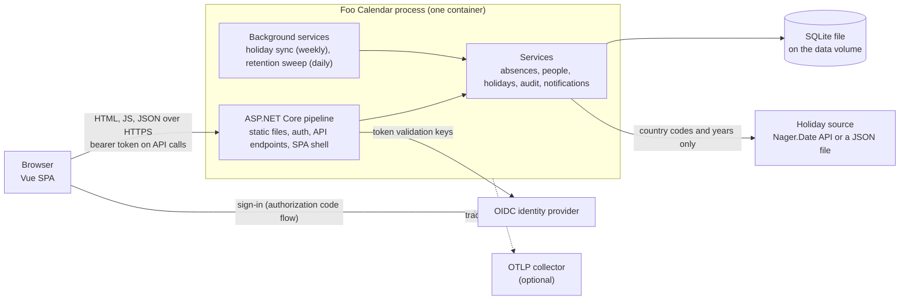
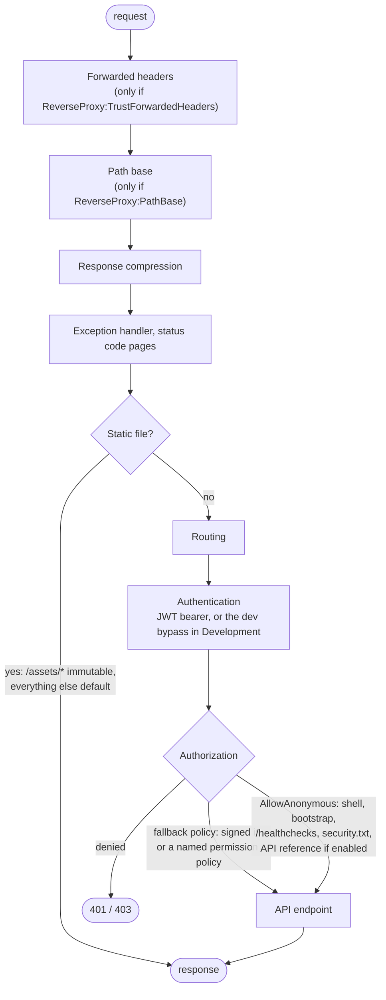
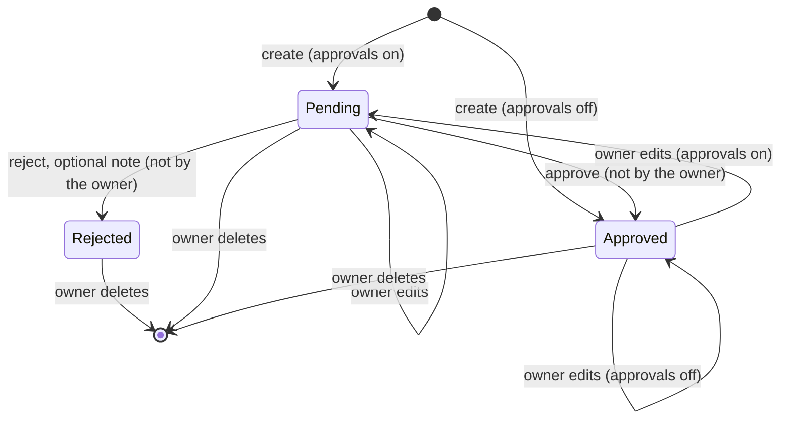

# Architecture

How the pieces fit, in the order a reader usually needs them. Why each piece is shaped this
way is in the [decision records](decisions/README.md); this page links to them rather than
repeating them.

## The system in one picture

One process serves the API and the SPA, keeps its state in one SQLite file, and talks to at
most three outside systems, all of them configured by the deployer
([0002](decisions/0002-one-deployable-unit.md), [0003](decisions/0003-sqlite-single-instance.md)).



Nothing else leaves the process: no email, no webhooks, no analytics
([0008](decisions/0008-in-app-notifications-only.md)). Absence notes never cross any of
those arrows ([0007](decisions/0007-no-special-category-data.md)).

## Startup

`Program.cs` reads top to bottom in the order things happen, with one catch: options are
registered with their validation near the top, but most of that validation runs later,
after migrations.

1. **Options are bound and their validation rules attached** (`ValidateOnStart`). Two
   retired setting shapes (`Auth:AdminPermission(s)`, a scalar
   `Auth:ClaimTypes:Permissions`) are rejected on the spot.
2. **Services are registered.** The holiday source is chosen here from `Holidays:Source`
   (Nager, File, or None), and the sync job is only registered when there is a source.
3. **The dev bypass announces itself**: with `Auth:Provider=None` a warning is logged.
4. **Migrations are applied** to the SQLite file, so upgrading is pulling a newer image.
5. **The pipeline is assembled and the SPA shell prepared once**, when a frontend build is
   present: `index.html` is read, its `<base href>` rewritten for a sub-path deployment,
   and the bootstrap config inlined as `window.__bootstrap`
   ([0004](decisions/0004-runtime-configuration.md)). Reading the team and auth options
   for that payload is the first point their validation runs.
6. **The host starts**: it validates the remaining options, then starts the background
   services. The holiday sync runs immediately and then every `Holidays:SyncInterval`; the
   retention sweep runs immediately and then every `Retention:SweepInterval` (daily).

So a missing identity provider setting, a permission with no claim values, or
`Auth:Provider=None` outside Development stops the process with a message saying what to
set before it serves a request, but after migrations have run.

## A request through the pipeline

Middleware order is load-bearing here, and `Program.cs` comments each step. The two
optional steps at the top exist only when a reverse proxy is configured.



Why the order matters:

- **Forwarded headers first**, so everything after sees the original caller's scheme, host
  and address rather than the proxy's.
- **Path base before routing.** Left implicit, ASP.NET Core inserts routing at the very
  start, where it would match paths before the prefix is stripped and send every sub-path
  API call to the SPA fallback. Routing is therefore placed explicitly.
- **Static files before routing**, so assets are served without consulting routing or
  authentication. They are public build output.
- **Authorization is closed by default.** An endpoint that says nothing requires a signed-in
  user; permissions are policies named after them
  ([0006](decisions/0006-fail-closed-per-permission-authorization.md)).
- **Domain errors become problem details.** Services throw `KeyNotFoundException` (404),
  `UnauthorizedAccessException` (403), `InvalidOperationException` (409) and
  `ArgumentException` (400); `DomainExceptionHandler` maps them, and anything else is a 500.

## Backend layout

```
src/Api/
├── Program.cs         composition root: options, services, auth, pipeline, in that order
├── Configuration/     typed options, each validated at startup; the permission list
├── Endpoints/         minimal-API route groups; thin, they resolve the caller and delegate
├── Services/          the domain logic, one service per concern, plus the holiday sources,
│                      background jobs and small helpers (CSV, region codes, LIKE escaping)
├── Interfaces/        what endpoints and tests depend on
├── Data/              EF Core context, entities, the bundled region name table
├── Migrations/        EF Core migrations, applied at startup
├── Dtos/              request and response records; request validation lives on them
└── Infrastructure/    SPA shell, dev auth bypass, exception mapping, OpenAPI transformer
```

The domain services take each other through interfaces, which is what lets the unit tests
swap a collaborator for a recording fake while running real queries against SQLite.

## Absence lifecycle

The approval workflow is off by default, in which case every absence is created
`Approved`. `AbsenceService` enforces these transitions; the ones marked "approvals on"
need `AbsenceApprovals:Enabled`. Approving and rejecting do not, so a request left pending
when the workflow is turned off can still be resolved.



- **Rejected is a dead end.** It cannot be edited back to life; the way forward is a new
  request. It also stops reserving its dates.
- **Reviews are race-safe.** Approve and reject are a conditional `UPDATE ... WHERE
  Status = Pending`, so of two reviewers acting at once, one wins and the other is told the
  request is no longer pending. The audit entry and the notification commit in the same
  transaction as the status change.
- **Overlaps are checked inside a serializable transaction**, against the same person's
  other absences. A whole-day absence blocks any other on its days; any number of
  time-based absences may share a day.

## Frontend

```
src/Web/src/
├── main.ts         reads the inlined bootstrap config, starts OIDC, mounts the app
├── auth/           oidc-client-ts setup, the dev bypass, the token and permission store
├── router/         routes; the guard signs in, and checks permissions only where a route asks
├── api/            one module per API area; apiFetch attaches the bearer token
├── stores/         Pinia stores for config, people, the signed-in person, notifications
├── composables/    small shared behaviours (floating panels, stale-response guards)
├── layouts/        the signed-in shell and the admin shell with its sidebar
├── types/          DTO and config types shared across the app
├── styles/         theme.css, the design tokens a deployer re-skins
├── lib/            framework-free logic, unit tested: segments, geometry, caching, dates
├── components/     CalendarGrid is the windowed grid; the rest are views' building blocks
├── views/          pages, with admin sections behind their own permissions
└── docs/           Markdown served in-app at /docs (usage, FAQ, installation, privacy,
                    terms, changelog)
```

Two designs carry most of the frontend's performance:

- **The calendar is a windowed grid.** Only rows in view are rendered, one element per
  absence segment, and pointer events resolve by arithmetic over fixed geometry, so the DOM
  stays around 3,300 nodes whatever the team size
  ([0010](decisions/0010-windowed-calendar-grid.md)).
- **Data paints from cache, then revalidates.** Year-scoped `localStorage` entries render
  immediately; a background refetch is reconciled into the existing objects, so an
  unchanged response re-renders nothing ([0011](decisions/0011-client-side-stale-while-revalidate.md)).

`tools/perf/harness.mjs` measures both against a running build; its README holds the
baseline.

## Where to look next

- [Threat model](threat-model.md): trust boundaries, what is exposed, and the accepted gaps.
- [Data protection](data-protection.md): every personal-data field and where data goes.
- [Deployment](deployment.md), [Access control](access-control.md),
  [Regions and holidays](regions-and-holidays.md), [Administration](administration.md):
  operating it.
