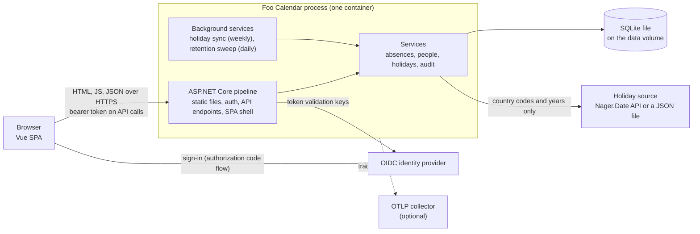
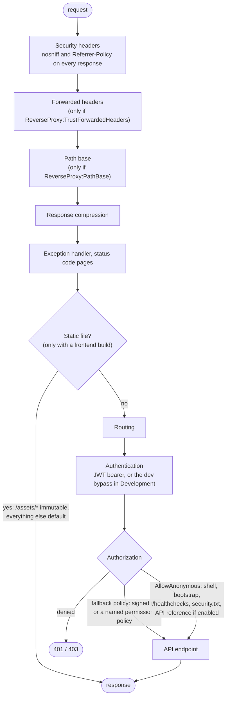

# Architecture

How the pieces fit, in the order a reader usually needs them. Why each piece is shaped this
way is in the [decision records](decisions/README.md); this page links to them rather than
repeating them.

## The system in one picture

One process serves the API and the SPA, keeps its state in one SQLite file, and talks to at
most three outside systems, all of them configured by the deployer
([0002](decisions/0002-one-deployable-unit.md), [0003](decisions/0003-sqlite-single-instance.md)).



Nothing else leaves the process: no email, no webhooks, no analytics
([0008](decisions/0008-in-app-notifications-only.md)). Absence notes never cross any of
those arrows ([0007](decisions/0007-no-special-category-data.md)).

## Startup

`Program.cs` reads top to bottom in the order things happen.

1. **Options are bound and their validation rules attached** (`ValidateOnStart`). Two
   retired setting shapes (`Auth:AdminPermission(s)`, a scalar
   `Auth:ClaimTypes:Permissions`) and the settings of the removed approval workflow
   (`AbsenceApprovals:Enabled` other than `false`, `Auth:Permissions:AbsencesApprove`) are
   rejected on the spot.
2. **Services are registered.** The holiday source is chosen here from `Holidays:Source`
   (Nager, File, or None), and the sync job is only registered when there is a source.
3. **The dev bypass announces itself**: with `Auth:Provider=None` a warning is logged.
4. **Every option is validated**, by running the checks `ValidateOnStart` registered
   rather than waiting for the host to run them when it starts. That includes the values
   parsed only later, such as the proxy addresses and the holiday source URL.
5. **The SPA shell is prepared once**, when a frontend build is present: `index.html` is
   read, its `<base href>` rewritten for a sub-path deployment, and the bootstrap config
   inlined as `window.__bootstrap`
   ([0004](decisions/0004-runtime-configuration.md)). Its Content-Security-Policy is
   built here too, from the SHA-256 of that same inlined script, so the two cannot
   disagree ([0015](decisions/0015-strict-content-security-policy.md)). A shell with no
   `</head>`, or with no `<base href>` while `ReverseProxy:PathBase` is set, stops the
   process here.
6. **Migrations are applied** to the SQLite file, so upgrading is pulling a newer image.
7. **The pipeline is assembled**, and the prepared shell mapped as the fallback route for
   GET and HEAD. An API path no route takes is kept from it: a 404 problem, or a 401 to
   someone not signed in.
8. **The host starts** the background services. The holiday sync runs immediately and
   then every `Holidays:SyncInterval`; the retention sweep runs immediately and then every
   `Retention:SweepInterval` (daily).

So a missing identity provider setting, a permission with no claim values, a malformed
proxy address, or `Auth:Provider=None` outside Development stops the process with a message
saying what to set, before it has touched the database or served a request.

## A request through the pipeline

Middleware order is load-bearing here, and `Program.cs` comments each step. The two
optional steps at the top exist only when a reverse proxy is configured.



Why the order matters:

- **Security headers before anything that can answer**, and written as the response
  starts, so a static file, a 401 and a 500 from the exception handler carry them like any
  other response. The shell's fallback route adds its own Content-Security-Policy; the API
  reference gets a separate one, with a per-response nonce, so it cannot loosen the
  shell's (`SecurityHeaders`).
- **Forwarded headers first**, so everything after sees the original caller's scheme, host
  and address rather than the proxy's.
- **Path base before routing.** Left implicit, ASP.NET Core inserts routing at the very
  start, where it would match paths before the prefix is stripped and send every sub-path
  API call to the SPA fallback. Routing is therefore placed explicitly.
- **Static files before routing**, so assets are served without consulting routing or
  authentication. They are public build output.
- **Authorization is closed by default.** An endpoint that says nothing requires a signed-in
  user; permissions are policies named after them
  ([0006](decisions/0006-fail-closed-per-permission-authorization.md)).
- **Domain errors become problem details.** Services throw a `DomainException`:
  `InvalidInputException` (400), `NotOwnerException` (403), `NotFoundException` (404) or
  `ConflictException` (409). `DomainExceptionHandler` answers it with its status and the
  rule's message. Anything else is a 500 that carries no exception detail, in Development
  too, and is logged.

## Backend layout

```
src/Api/
├── Program.cs         composition root: options, services, auth, pipeline, in that order
├── Configuration/     typed options, each validated at startup; the permission list
├── Endpoints/         minimal-API route groups; thin, they resolve the caller and delegate
├── Services/          the domain logic, one service per concern, plus the holiday sources,
│                      background jobs and small helpers (CSV, region codes, LIKE escaping)
├── Interfaces/        what endpoints and tests depend on
├── Data/              EF Core context, entities, the bundled region name table
├── Migrations/        EF Core migrations, applied at startup
├── Dtos/              request and response records; request validation lives on them
└── Infrastructure/    SPA shell, dev auth bypass, exception mapping, OpenAPI transformer
```

The domain services take each other through interfaces, which is what lets the unit tests
swap a collaborator for a recording fake while running real queries against SQLite.

## Absences and overlaps

An absence has no lifecycle beyond existing: it is in effect from the moment its owner
creates it until they delete it, and only its owner can change it
([0014](decisions/0014-remove-absence-approvals.md)). What `AbsenceService` does enforce
is which absences may coexist for one person:

| A new or edited absence | Overlaps an existing whole-day absence | Overlaps an existing time-based one |
| --- | --- | --- |
| Whole-day | Conflict (409) | Conflict (409) |
| Time-based (one day, start and end time) | Conflict (409) | Allowed, times unchecked |

- **Overlap means sharing a day.** Ranges are inclusive, so an absence starting on the day
  another ends overlaps it. Other people's absences never conflict.
- **The check and the write are atomic.** Both run inside a serializable transaction,
  which on SQLite takes the write lock up front, so two concurrent requests cannot both
  pass the check and land overlapping absences.
- **An edit is checked against everything but itself.**

## Frontend

```
src/Web/src/
├── main.ts         reads the inlined bootstrap config, starts OIDC, mounts the app
├── auth/           oidc-client-ts setup, sign-in and sign-out, the dev bypass, the token
│                   and permission store
├── router/         routes; the guard signs in, and checks permissions only where a route asks
├── api/            one module per API area; apiFetch attaches the bearer token
├── stores/         Pinia stores for config, people, the signed-in person
├── composables/    small shared behaviours (floating panels, stale-response guards)
├── layouts/        the signed-in shell and the admin shell with its sidebar
├── types/          DTO and config types shared across the app
├── styles/         theme.css, the design tokens a deployer re-skins
├── lib/            framework-free logic, unit tested: segments, geometry, caching, dates
├── components/     CalendarGrid is the windowed grid; the rest are views' building blocks
├── views/          pages, with admin sections behind their own permissions
└── legal/          the privacy notice and terms, filled in per deployment and served at
                    /privacy and /terms; the rest of the documentation is in the
                    repository (0019)
```

Two designs carry most of the frontend's performance:

- **The calendar is a windowed grid.** Only rows in view are rendered, one element per
  absence segment, and pointer events resolve by arithmetic over fixed geometry, so the DOM
  stays around 3,300 nodes whatever the team size
  ([0010](decisions/0010-windowed-calendar-grid.md)).
- **Data paints from cache, then revalidates.** Year-scoped `localStorage` entries render
  immediately; a background refetch is reconciled into the existing objects, so an
  unchanged response re-renders nothing ([0011](decisions/0011-client-side-stale-while-revalidate.md)).

`tools/perf/harness.mjs` measures both against a running build; its README holds the
baseline, and CI holds every build to it (see [Checks](#checks)).

The shell runs under a strict Content-Security-Policy: scripts only from the app's origin
plus the inlined bootstrap script by its hash, styles only from the app's origin,
connections only to the app, the identity provider and any extra provider origins the
deployment names, and no frames to the provider
([0015](decisions/0015-strict-content-security-policy.md),
[0017](decisions/0017-csp-and-budget-adjustments.md)). `index.html` itself is never served
from disk, only as the prepared shell. Vue's style bindings set
properties through the CSSOM, which the policy does not restrict, so nothing in the SPA
needs inline styles; a dependency that starts injecting style or script elements fails the
end-to-end suite.

## Background jobs and telemetry

The holiday sync and the retention sweep are hosted services that wake on a
`PeriodicTimer`. A country the sync cannot fetch is logged and reported while the others
carry on; a failed sweep is logged and retried on the next tick. Because nobody watches
them run, they report through OpenTelemetry under
the app's own activity source and meter, `FooCalendar` (`Infrastructure/AppTelemetry.cs`):

- spans `holiday_sync` (one per year synced) with a `holiday_sync.country` child per
  country, and `retention_sweep`;
- metrics `foo_calendar.holiday_sync.runs`, `foo_calendar.holiday_sync.failed_countries`,
  `foo_calendar.holiday_sync.duration` (bucketed in seconds),
  `foo_calendar.retention.deleted_rows` and `foo_calendar.retention.failed_sweeps`.

A sync stopped by shutdown is marked cancelled rather than failed, so stopping the app never
reads as the holiday source failing.

Their attributes are region and country codes, years, counts, outcomes and exception types,
never a username, a name or a note (OBS-3). [Deployment](deployment.md#the-apps-own-spans-and-metrics)
lists every attribute.

## Checks

Every push and pull request runs `.github/workflows/ci.yml`, and `scripts/check.sh` runs the
same checks locally, the end-to-end suite and the performance budget included. What each
one fails on is in the [developer guide](development.md#checking-a-change).

## Where to look next

- [Threat model](threat-model.md): trust boundaries, what is exposed, and the accepted gaps.
- [Data protection](data-protection.md): every personal-data field and where data goes.
- [Developer guide](development.md): running it, seeding, debugging, the checks and the
  changes with a set procedure.
- [Deployment](deployment.md), [Access control](access-control.md),
  [Regions and holidays](regions-and-holidays.md), [Administration](administration.md):
  operating it.
