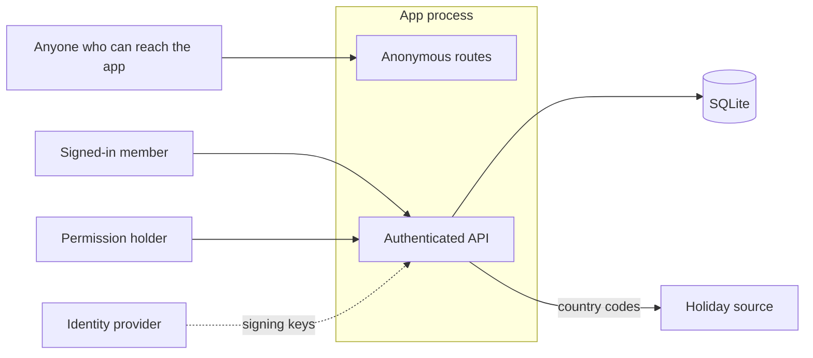

# Threat model

What this app protects, from whom, where the boundaries are, and which risks are accepted
rather than mitigated. Written against the code as of 2026-11-23; each mitigation names
where it lives so it can be checked rather than trusted.

## Scope and assumptions

- One team self-hosts one instance, reachable by its members over HTTPS.
- **The operator is trusted.** Whoever sets configuration and environment variables can
  already read the database file. Configuration values are treated as trusted input.
- **The identity provider is trusted** to authenticate people and to issue tokens for this
  app only to the people who should have them.
- **TLS is terminated in front of the app**, by a reverse proxy or the platform. The
  container listens on plain HTTP on port 8080 and does not redirect or send HSTS itself.

## What is worth protecting

| Asset | Why it matters |
| --- | --- |
| Absence notes | The one free-text personal field; may contain things its author meant for nobody else |
| The team's absences and regions | Personal data: who is away, when, and roughly where they live |
| The audit log's integrity | The answer to "who changed this" after the fact |
| Access tokens in the browser | Whoever holds one acts as that person until it expires |
| Availability of the calendar | A team planning leave around it |

What it deliberately does not hold: passwords or other credentials
([0005](decisions/0005-oidc-only-authentication.md)), and health data
([0007](decisions/0007-no-special-category-data.md)).

## Trust boundaries and entry points

Anonymous routes, the complete list: the routes marked `.AllowAnonymous()` in the code,
plus the files under `wwwroot`, which the static file middleware serves before
authentication runs.

| Route | Exposes |
| --- | --- |
| SPA shell and static assets | Public build output, plus the inlined bootstrap payload: the OIDC settings the browser needs to start a sign-in, the team's name, support and issue links, and the claim types and values that grant each permission |
| `GET /api/config/bootstrap` | The same bootstrap payload, for the Vite dev server |
| `GET /healthchecks` | One word: `Healthy`, `Degraded` or `Unhealthy`. Per-check detail needs `AuditRead` |
| `GET /.well-known/security.txt` | The configured security contact |
| `/openapi/v1.json`, `/scalar` | The API's shape, never its data. Off outside Development unless `ApiDocs:Enabled` |

Everything else requires a valid bearer token, by the fallback policy, and some routes a
named permission on top ([0006](decisions/0006-fail-closed-per-permission-authorization.md)).

## Threats and mitigations

### Spoofing

| Threat | Mitigation |
| --- | --- |
| A forged or foreign token | JWT bearer validation against `Auth:Authority` and `Auth:Audience` (`Program.cs`) |
| The dev bypass reaching production | `Auth:Provider=None` is refused outside Development at startup, and logs a warning when on |
| A client forging its address in logs via `X-Forwarded-For` | Forwarded headers are ignored unless `ReverseProxy:TrustForwardedHeaders` is set, and can be limited to known proxies |

### Tampering

| Threat | Mitigation |
| --- | --- |
| Editing or deleting someone else's absence | The service compares the absence's owner to the caller and answers 403 (`AbsenceService`) |
| Two concurrent requests landing overlapping absences | The overlap check and the write share a serializable transaction (`AbsenceService`) |
| Rewriting the audit log | No endpoint updates or deletes entries; only the retention sweep removes aged ones |
| A LIKE wildcard in a search widening it | Search terms are escaped (`SqlLikePattern`) |

### Repudiation

Every create, update and delete someone makes through the API (people, absences, manual
bank holidays), every import and every hand-triggered sync is written to the audit log
with the actor's username, and rows carry `CreatedBy`/`UpdatedBy`. Entries survive the
people they name, bounded by `Retention:AuditEntryDays`.

What follows on its own is not in the audit log: a region's holidays deleted when its last
occupant leaves (manual ones included, `TeamRegionService.PruneIfUnusedAsync`), the
absences that cascade with a deleted person (only their count is recorded), the scheduled
holiday sync, and the retention sweep. Those reach the application log, if at all.

### Information disclosure

| Threat | Mitigation |
| --- | --- |
| Notes read by colleagues | Projected away in the database query for anyone but the author, admins included; never in the audit log ([0007](decisions/0007-no-special-category-data.md)) |
| The next user of a shared browser reading the cached calendar | Sign-out removes every key under the app's storage prefix in `localStorage` and `sessionStorage` (`clearAppStorage` in `lib/browserCache.ts`), removes the OIDC session through the library, and ends the provider's session where it has an end-session endpoint (`signOut` in `auth/index.ts`) |
| Internals in health check output | The anonymous endpoint returns only the overall status; exception messages and paths are behind `AuditRead` |
| A crafted country code steering the outbound holiday request | Validated as ISO 3166 before it is put into the upstream URL (`RegionEndpoints`) |
| A config value breaking out of the inlined `<script>` | Serialized with the default JSON encoder, which escapes `<`, `>` and `&` (`SpaShell`) |
| Data leaving the system | Only country codes to the holiday source, sign-in and sign-out traffic to the IdP, and traces, metrics and logs to an OTLP collector if the deployer configures one; no email, webhooks or analytics ([0008](decisions/0008-in-app-notifications-only.md)) |

### Denial of service

| Threat | Mitigation |
| --- | --- |
| An unbounded list response | The audit log and the admin people list are paged, at most 200 rows a page. `GET /api/absences` and `GET /api/bank-holidays/catalog` refuse a range over 366 days (`ReadRange`). `GET /api/people` returns the whole team, which is bounded by the team's size |
| A pathological regex input | The one hand-checked pattern is source-generated with a match timeout |
| A huge request body (the CSV import reads it whole) | Kestrel's default 30 MB body limit applies; the endpoint needs `PeopleManage` |
| A holiday source that is down | Failures are per country, reported and retried; a profile save never fails on it |

### Elevation of privilege

| Threat | Mitigation |
| --- | --- |
| Reaching a route nobody protected | The fallback policy requires a signed-in user on every endpoint by default |
| Relying on the SPA hiding a button | The API enforces every permission itself; the SPA only decides what to offer |
| A misconfigured permission granting nothing, or everything | Startup refuses unknown permission names and permissions with no claim values |

## Accepted risks and known gaps

These are open on purpose or not yet addressed. Each is a candidate for its own decision
record when it is.

1. **Everyone the identity provider will issue a token to can read the whole calendar.**
   Reading absences needs only a signed-in user. Restricting who can sign in (application
   assignment in the IdP) is the deployer's control, and the one that matters most.
2. **No security headers.** The app sets no Content-Security-Policy, `X-Content-Type-Options`
   or `frame-ancestors`. Add them at the reverse proxy for now. Their absence matters most
   because of the next point.
3. **Tokens live in `sessionStorage`** (the `oidc-client-ts` default), so script injected
   into the page could read them. Vue escapes all interpolated data; the one `v-html` renders
   the bundled in-app docs, whose only dynamic parts are the operator's `Team:OrgName` and
   `Team:SupportUrl`.
4. **No rate limiting.** Apart from the anonymous routes above, every API route needs a
   token, which bounds who can try, but not how often. `/healthchecks` runs the database
   check on every anonymous call.
5. **Manual bank holidays are editable by every member**, by design
   ([0006](decisions/0006-fail-closed-per-permission-authorization.md)). Misuse is visible
   in the audit log rather than prevented.
6. **The database is unencrypted at rest.** Disk or volume encryption is the host's job.
7. **The dev bypass is guarded only by `ASPNETCORE_ENVIRONMENT`.** A production deployment
   started with `Development` would run without authentication, announced in the log.
8. **One instance** ([0003](decisions/0003-sqlite-single-instance.md)): availability is the
   container's and the host's.
9. **The browser keeps a copy of the calendar until sign-out.** A year of the team's
   absences (with the viewer's own notes), the holidays, the people list and the viewer's
   profile are cached in `localStorage`
   ([0011](decisions/0011-client-side-stale-while-revalidate.md)). Signing out removes
   them; closing the tab does not. On a shared computer, a member who leaves without
   signing out leaves them for the next user of the browser profile. Sign-out also ends the
   provider's session only when the provider advertises an end-session endpoint.
10. **The bootstrap payload is public.** It names the claim values that grant each
    permission, such as group ids or role names, to anyone who can reach the app (see the
    table above). `SpaShell` and `ConfigEndpoints` serve it anonymously because the SPA needs
    it before sign-in.

## Reporting a vulnerability

Each deployment publishes its own contact at `/.well-known/security.txt` (from
`Team:SecurityContact`, falling back to `Team:SupportUrl`). Issues in the software itself
go to the [repository's issue tracker](https://github.com/yergios/foo-calendar/issues);
leave exploit details out of a public issue and ask there for a private channel first.
